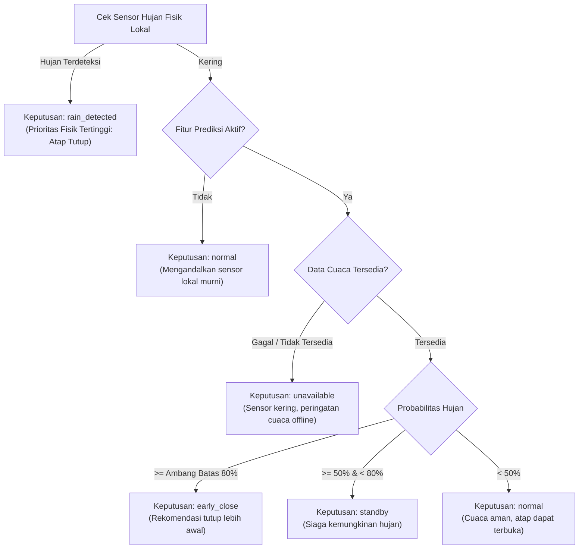

# Weather-Responsive Roofing System V2.0 — FastAPI Backend

Backend REST API untuk **Weather-Responsive Roofing System untuk Perlindungan Jemuran Otomatis V2.0**, yang mengintegrasikan sistem kendali atap berbasis sensor lokal dan prediksi cuaca eksternal (BMKG / OpenWeatherMap) untuk fitur *Early-Close*.

Backend ini dirancang khusus untuk terintegrasi dengan **Frontend React + Vite** dan **Firmware ESP8266** melalui protokol MQTT atau simulasi internal.

---

## Daftar Isi
1. [Arsitektur Sistem](#arsitektur-sistem)
2. [Persyaratan Sistem](#persyaratan-sistem)
3. [Langkah Instalasi & Setup](#langkah-instalasi--setup)
4. [Konfigurasi Environment (.env)](#konfigurasi-environment-env)
5. [Inisialisasi Database & Pembuatan Akun](#inisialisasi-database--pembuatan-akun)
6. [Menjalankan Server Backend](#menjalankan-server-backend)
7. [Menjalankan Pengujian Otomatis (Pytest)](#menjalankan-pengujian-otomatis-pytest)
8. [Integrasi dengan Frontend React + Vite](#integrasi-dengan-frontend-react--vite)
9. [Mode Simulasi vs Real Device](#mode-simulasi-vs-real-device)
10. [Konfigurasi MQTT & Kontrak Pesan Firmware ESP8266](#konfigurasi-mqtt--kontrak-pesan-firmware-esp8266)
11. [Daftar Endpoint API & Contoh Request](#daftar-endpoint-api--contoh-request)
12. [Logika Keputusan Cuaca V2.0 (Early-Close)](#logika-keputusan-cuaca-v20-early-close)
13. [Batasan Sistem Saat Ini](#batasan-sistem-saat-ini)

---

## 1. Arsitektur Sistem

```text
React + Vite Frontend (Port 5173)
       ↓ (HTTP REST API / Bearer JWT)
FastAPI Backend (Port 8000 /api/v1)
  ├── Auth Service (Argon2 + JWT)
  ├── Dashboard Service (Aggregated status & ISO 8601 Asia/Jakarta)
  ├── Device Service (Heartbeat & Telemetry Tracking)
  ├── Control Service (Safety Locks & Command Dispatcher)
  ├── Weather Service (BMKG Open Data & OpenWeatherMap Fallback)
  ├── Decision Service V2.0 (Early-Close Algorithm)
  ├── History & Evaluation Service (Accuracy, Precision, Recall, F1 & CSV)
  ├── Settings Service (Persistent Dynamic Thresholds)
  ├── MQTT Client (Non-blocking Paho-MQTT v2)
  └── Database Layer (SQLAlchemy 2.x + SQLite)
       ↓
  ESP8266 IoT Hardware (MQTT Broker)
```

> [!IMPORTANT]
> **Kebijakan Keselamatan Fisik:** Sensor hujan lokal merupakan sumber kebenaran utama (*ground truth*). Backend menolak perintah manual untuk membuka atap jika sensor lokal mendeteksi presipitasi aktif (`RAIN_SAFETY_LOCK`). Logika keselamatan utama tetap diimplementasikan pada firmware ESP8266 secara independen.

---

## 2. Persyaratan Sistem
- Python 3.10, 3.11, atau 3.12 (Disarankan 3.12).
- Pip atau `uv` sebagai package manager.
- SQLite3 (sudah terintegrasi secara bawaan di Python).
- Broker MQTT (misal Mosquitto atau HiveMQ) jika menghubungkan hardware ESP8266 sungguhan.

---

## 3. Langkah Instalasi & Setup

### A. Clone atau Buka Folder Proyek
```bash
cd backendJ
```

### B. Membuat Virtual Environment
**Windows (PowerShell):**
```powershell
python -m venv .venv
.\.venv\Scripts\activate
```

**Linux / macOS:**
```bash
python3 -m venv .venv
source .venv/bin/activate
```

*(Atau menggunakan `uv` jika terpasang: `uv venv --python 3.12 .venv`)*

### C. Menginstal Dependensi
```bash
pip install -r requirements.txt
```

---

## 4. Konfigurasi Environment (`.env`)

Salin file contoh `.env.example` menjadi `.env`:
```bash
copy .env.example .env     # Windows
cp .env.example .env       # Linux / macOS
```

### Parameter Utama `.env`:
| Variabel | Default | Keterangan |
| :--- | :--- | :--- |
| `APP_ENV` | `development` | Mode aplikasi (`development`, `production`, `testing`) |
| `APP_HOST` | `127.0.0.1` | Host server backend |
| `APP_PORT` | `8000` | Port server backend |
| `DATABASE_URL` | `sqlite:///./weather_roofing.db` | URL Database SQLite |
| `FRONTEND_ORIGINS` | `http://localhost:5173` | Alamat origin frontend React untuk CORS |
| `JWT_SECRET_KEY` | *(acak)* | Kunci rahasia enkripsi token JWT |
| `DEVICE_MODE` | `simulation` | `simulation` (tanpa hardware) atau `real` (dengan ESP8266) |
| `DEVICE_OFFLINE_TIMEOUT_SECONDS` | `120` | Batas waktu deteksi offline berdasarkan heartbeat |
| `MQTT_ENABLED` | `false` | Aktifkan/nonaktifkan koneksi MQTT client |
| `MQTT_HOST` | `localhost` | Host broker MQTT |
| `MQTT_PORT` | `1883` | Port broker MQTT |
| `WEATHER_PROVIDER` | `bmkg` | Provider utama cuaca (`bmkg` atau `openweathermap`) |
| `WEATHER_LOCATION` | `DKI Jakarta` | Wilayah perkiraan cuaca |
| `EARLY_CLOSE_THRESHOLD` | `80` | Ambang probabilitas hujan early-close (%) |
| `EARLY_CLOSE_HORIZON_MINUTES` | `60` | Horizon waktu prakiraan hujan (menit) |

---

## 5. Inisialisasi Database & Pembuatan Akun

Jalankan perintah CLI berikut untuk membuat seluruh tabel database, pengaturan bawaan, perangkat default (`roof-001`), dan akun administrator awal:

```bash
python run.py init-db
```

Secara default, akun administrator awal adalah:
- **Username:** `admin`
- **Password:** `adminPassword123!`
- **Email:** `admin@jemuran.local`

Untuk membuat atau mereset akun admin khusus:
```bash
python run.py create-admin --username admin_baru --email admin@example.com --password RahasiaKuat123! --full-name "Admin Jemuran"
```

---

## 6. Menjalankan Server Backend

Jalankan perintah berikut:
```bash
python run.py
```
atau menggunakan Uvicorn langsung:
```bash
uvicorn app.main:app --reload --host 127.0.0.1 --port 8000
```

- **API Base URL:** `http://127.0.0.1:8000/api/v1`
- **Swagger Interactive API Docs:** `http://127.0.0.1:8000/docs`
- **ReDoc:** `http://127.0.0.1:8000/redoc`

---

## 7. Menjalankan Pengujian Otomatis (Pytest)

Suite pengujian mencakup 17 skenario wajib, meliputi autentikasi, status perangkat, validasi safety lock hujan, prediksi early-close, ekspor CSV, handling payload MQTT rusak, dan error handling.

Jalankan:
```bash
pytest -v
```

Hasil uji:
```text
tests/test_roofing_system.py::test_01_health_check PASSED
tests/test_roofing_system.py::test_02_login_success_and_failure PASSED
tests/test_roofing_system.py::test_03_authenticated_endpoints_protection PASSED
tests/test_roofing_system.py::test_04_get_dashboard_summary PASSED
tests/test_roofing_system.py::test_05_get_device_status PASSED
tests/test_roofing_system.py::test_06_change_operation_mode PASSED
tests/test_roofing_system.py::test_07_validate_open_close_commands PASSED
tests/test_roofing_system.py::test_08_device_offline_handling PASSED
tests/test_roofing_system.py::test_09_rain_detected_safety_lock PASSED
tests/test_roofing_system.py::test_10_forecast_early_close_threshold PASSED
tests/test_roofing_system.py::test_11_weather_api_failure_and_fallback PASSED
tests/test_roofing_system.py::test_12_empty_history_data PASSED
tests/test_roofing_system.py::test_13_history_filtering PASSED
tests/test_roofing_system.py::test_14_export_csv PASSED
tests/test_roofing_system.py::test_15_invalid_settings_validation PASSED
tests/test_roofing_system.py::test_16_mqtt_unavailable_handling PASSED
tests/test_roofing_system.py::test_17_mqtt_invalid_payload_handling PASSED
======================= 17 passed in 5.41s ========================
```

---

## 8. Integrasi dengan Frontend React + Vite

Pada proyek frontend React (`frontendJ`):
1. Buat atau perbarui file `.env` di direktori frontend:
   ```env
   VITE_API_BASE_URL=http://127.0.0.1:8000/api/v1
   ```
2. Pastikan file frontend melakukan request HTTP dengan menyertakan header token:
   ```javascript
   headers: {
     'Authorization': `Bearer ${accessToken}`,
     'Content-Type': 'application/json'
   }
   ```
3. CORS di backend telah diatur untuk menerima `http://localhost:5173` dan `http://127.0.0.1:5173`. Jika menggunakan port lain, tambahkan pada `FRONTEND_ORIGINS` di `.env` backend.

---

## 9. Mode Simulasi vs Real Device

### Mode Simulasi (`DEVICE_MODE=simulation`)
- Memungkinkan dashboard React diuji secara penuh tanpa memerlukan mikrokontroler ESP8266 atau broker MQTT fisik.
- Status koneksi perangkat tetap `online` melalui loop heartbeat simulasi otomatis.
- Perintah `open` dan `close` langsung diperbarui statusnya dan tercatat di tabel riwayat aktivitas.

### Mode Real Device (`DEVICE_MODE=real`)
- Menggunakan hardware ESP8266 fisik.
- Perangkat dianggap `online` hanya bila pesan status/telemetri diterima dalam jangka waktu `DEVICE_OFFLINE_TIMEOUT_SECONDS` (120 detik). Jika tidak ada pesan, otomatis berstatus `offline`.
- Perintah manual diterbitkan ke topik MQTT `atap/{id}/command`.

---

## 10. Konfigurasi MQTT & Kontrak Pesan Firmware ESP8266

Aktifkan di `.env`:
```env
MQTT_ENABLED=true
MQTT_HOST=192.168.1.100 # alamat IP broker MQTT Anda
MQTT_PORT=1883
```

### Kontrak Topik & Payload MQTT

#### 1. Telemetri Sensor: `atap/{device_id}/sensors` (ESP8266 ➔ Backend)
```json
{
  "rain_detected": false,
  "rain_analog": 1023,
  "light_lux": 520.0,
  "temperature": 29.5,
  "humidity": 64.0
}
```

#### 2. Status Perangkat & Heartbeat: `atap/{device_id}/status` (ESP8266 ➔ Backend)
```json
{
  "roof_status": "closed",
  "mode": "auto",
  "rssi": -62
}
```

#### 3. Kendali Motor Atap: `atap/{device_id}/command` (Backend ➔ ESP8266)
```json
{
  "command": "open",
  "command_id": "c7a6e60b-85d8-4f8a-9e19-3f0e046a9b47"
}
```

#### 4. Konfirmasi Eksekusi Perintah: `atap/{device_id}/command_ack` (ESP8266 ➔ Backend)
```json
{
  "command_id": "c7a6e60b-85d8-4f8a-9e19-3f0e046a9b47",
  "status": "succeeded",
  "roof_status": "open",
  "detail": "Stepper motor bergerak penuh ke posisi terbuka."
}
```

#### 5. Ringkasan Prediksi Cuaca: `atap/{device_id}/forecast` (Backend ➔ ESP8266)
```json
{
  "probability_of_rain": 85.0,
  "horizon_minutes": 60,
  "recommendation": "early_close"
}
```

---

## 11. Daftar Endpoint API & Contoh Request

Prefix rute: `/api/v1`

### A. Autentikasi (`/auth`)
- `POST /api/v1/auth/login`: Login dengan username/email dan password.
  ```json
  // Request Body
  {
    "username": "admin",
    "password": "adminPassword123!"
  }
  // Response 200 OK
  {
    "access_token": "eyJhbGciOi...",
    "token_type": "bearer",
    "expires_in_minutes": 60,
    "user": {
      "id": 1,
      "username": "admin",
      "email": "admin@jemuran.local",
      "is_admin": true,
      "is_active": true,
      "created_at": "2026-10-16T12:00:00+07:00"
    }
  }
  ```
- `GET /api/v1/auth/me`: Informasi profil pengguna aktif (Perlu Bearer Token).
- `POST /api/v1/auth/logout`: Konfirmasi logout sisi klien.

### B. Dashboard (`/dashboard`)
- `GET /api/v1/dashboard/summary`: Agregasi lengkap status atap, koneksi, keputusan V2.0, ringkasan cuaca, dan 5 aktivitas terakhir.
- `GET /api/v1/dashboard/status`: Data status instan dan keputusan sistem.

### C. Perangkat (`/devices`)
- `GET /api/v1/devices`: Daftar semua perangkat atap.
- `GET /api/v1/devices/{device_id}`: Detail perangkat spesifik.
- `GET /api/v1/devices/{device_id}/status`: Status telemetri dan koneksi perangkat.

### D. Kendali Atap (`/devices/{device_id}`)
- `POST /api/v1/devices/{device_id}/commands`: Mengirim perintah buka/tutup atap.
  ```json
  // Request
  { "command": "close" }
  // Response 200 OK
  {
    "command_id": "8fa39103-6cb2-40ae-8239-cf4d2105e197",
    "device_id": "roof-001",
    "command": "close",
    "status": "succeeded",
    "detail": "Simulasi berhasil: Atap telah closed.",
    "issued_at": "2026-10-16T12:30:00+07:00",
    "executed_at": "2026-10-16T12:30:00+07:00"
  }
  ```
- `PATCH /api/v1/devices/{device_id}/mode`: Ubah mode operasi (`auto` atau `manual`).
  ```json
  { "mode": "manual" }
  ```

### E. Prediksi Cuaca (`/weather`)
- `GET /api/v1/weather/current`: Cuaca terkini (dengan cache 10–15 menit).
- `GET /api/v1/weather/forecast`: Prakiraan detail per jam/periode.
- `GET /api/v1/weather/status`: Metadata status ketersediaan provider dan cache expiry.
- `POST /api/v1/weather/refresh`: Paksa pembaruan data dari provider eksternal (dibatasi cooldown 60 detik).

### F. Riwayat & Evaluasi (`/history`)
- `GET /api/v1/history/activities`: Riwayat pergerakan atap & event log (dengan filter `event_type`, `source`, tanggal, dan paginasi).
- `GET /api/v1/history/sensors`: Riwayat sensor hujan & intensitas cahaya.
- `GET /api/v1/history/forecasts`: Riwayat ramalan cuaca yang pernah diambil.
- `GET /api/v1/history/evaluation`: Evaluasi akurasi, presisi, recall, dan F1-score prediksi terhadap sensor aktual.
- `GET /api/v1/history/export?data_type=activities`: Unduh berkas CSV riwayat aktivitas.
- `GET /api/v1/history/export?data_type=sensors`: Unduh berkas CSV rekaman sensor.

### G. Pengaturan (`/settings`)
- `GET /api/v1/settings`: Menampilkan ambang early-close, horizon waktu, dan jeda stabilisasi.
- `PATCH /api/v1/settings`: Memperbarui nilai parameter konfigurasi.

---

## 12. Logika Keputusan Cuaca V2.0 (Early-Close)

Implementasi pada `app/services/decision_service.py`:



---

## 13. Batasan Sistem Saat Ini
1. **Model Prediksi Hujan:** Probabilitas hujan bersumber dari API cuaca regional BMKG / OpenWeatherMap. Kondisi iklim mikro lokal tetap dikawal secara absolut oleh sensor hujan fisik pada ESP8266.
2. **Stateless JWT:** Token revocation berbasis blacklist server-side belum diaktifkan (logout menghapus token di sisi browser klien).
3. **Database Pengembangan:** Secara bawaan menggunakan SQLite. Untuk deployment production berskala multi-perangkat tinggi, `DATABASE_URL` dapat dialihkan ke PostgreSQL tanpa mengubah kode service layer.
